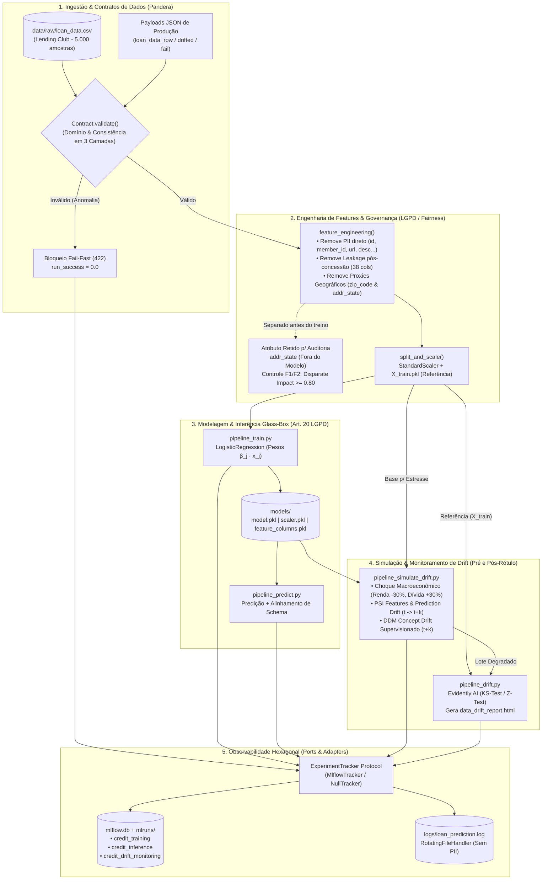
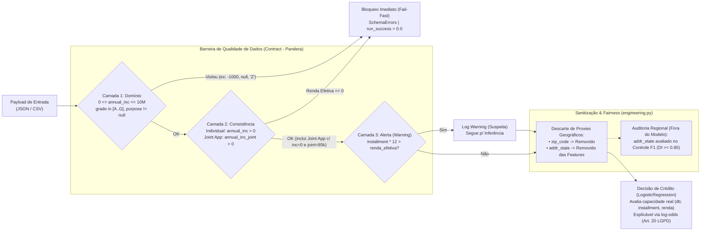

# Sistema de Observabilidade Contínua, Detecção de Drift, Qualidade de Dados e Governança em Produção

[](./pyproject.toml)
[](./src/default_pred/data/contract.py)
[](./src/default_pred/models/drift.py)
[](./src/default_pred/observability/)
[](#governança-de-dados-conformidade-lgpd-equidade-algorítmica-e-análise-causal)
[](./docs/presentation/index.html)

---

## 1. Visão Geral do Problema e Objetivo

Uma fintech de concessão de crédito opera um classificador de **Credit Scoring** (predição de inadimplência / *default*) em produção. Com mudanças macroeconômicas recentes — **inflação persistente e elevação da taxa de juros** — a diretoria identificou indícios de degradação silenciosa nas decisões do modelo.

Este projeto implementa a camada completa de **Sustentação, Confiabilidade, Observabilidade e Governança (MLOps)** para modelos de risco de crédito, estruturada em quatro pilares fundamentais:

* **Validação de Dados e Contratos (*Data Contracts*):** Treinamento do classificador baseline (`LogisticRegression`) sobre o dataset *Lending Club* e proteção da ingestão com regras estritas via **Pandera** (`Contract`), bloqueando registros inválidos (*fail-fast*).
* **Simulação e Detecção Estatística de Drift:** Simulação reprodutível de **Data Drift** ($P(X)$) e **Concept Drift** ($P(Y \mid X)$) sob estresse econômico (`drift_simulation.py`) e detecção estatística automatizada com **Evidently AI** (Kolmogorov-Smirnov e Z-test) combinada ao cálculo explícito de **PSI (*Population Stability Index*)**.
* **Observabilidade de Pipelines e Modelos:** Arquitetura Hexagonal (*Ports & Adapters*) integrando **MLflow** (`mlflow.db` com 3 experimentos dedicados) e **Logging Centralizado Rotativo** (`logs/loan_prediction.log`).
* **Governança, LGPD e Análise Causal:** Mapeamento de PII (*Privacy by Design* e *by Default*), enquadramento na Lei nº 13.709/2018 (LGPD), mitigação de vieses (*Fairness*), Grafo Causal (DAG) da degradação e apresentação executiva no método **STAR**.

---

## 2. Arquitetura do Projeto

### 2.1 Visão Geral do Fluxo MLOps (End-to-End)



### 2.2 Estrutura de Diretórios

```
.
├── data/
│   ├── raw/                        # Dataset bruto Lending Club (baixado sob demanda via kagglehub)
│   ├── processed/                  # Datasets de referência escalonados (X_train.pkl, X_test.pkl, ...)
│   └── entries/                    # Payloads JSON de inferência, falha de contrato e lotes com drift
│       ├── loan_data_row.json              # Registro individual válido
│       ├── loan_data_row_fail.json         # Registro inválido (viola as 3 regras do contrato Pandera)
│       ├── loan_data_drifted.json          # Lote de produção com Data Drift (1.000 amostras)
│       └── loan_data_concept_drifted.json  # Lote gerado pelo pipeline de Data + Concept Drift
├── docs/
│   └── presentation/
│       └── index.html              # Apresentação interativa e responsiva (Método STAR)
├── logs/
│   └── loan_prediction.log         # Log operacional centralizado com rotação automática (1 MB x 3)
├── models/                         # Artefatos serializados (logistic_regression_model.pkl, scaler.pkl)
├── notebooks/                      # Notebooks exploratórios (EDA.ipynb, Drift.ipynb)
├── src/default_pred/
│   ├── config.py                   # Caminhos, constantes, URIs do MLflow e limiares de alerta
│   ├── data/
│   │   ├── contract.py             # Contrato de dados Pandera (Contract)
│   │   └── load.py                 # Download automático (kagglehub) e loaders com validação
│   ├── features/
│   │   ├── engineering.py          # Sanitização de PII, codificações e limpeza de features
│   │   └── preprocessing.py        # Split estratificado e padronização (StandardScaler)
│   ├── models/
│   │   ├── train.py                # Treinamento da Regressão Logística baseline
│   │   ├── evaluate.py             # Cálculo de Accuracy, Precision, Recall, F1 e ROC-AUC
│   │   ├── predict.py              # Alinhamento de schema, checagem de drift e inferência
│   │   ├── drift.py                # Geração do relatório HTML do Evidently (DataDriftPreset)
│   │   └── drift_simulation.py     # Simulação Clean Code de Data Drift, Concept Drift e cálculo de PSI
│   ├── observability/
│   │   ├── tracker.py              # Porta (Protocol) ExperimentTracker e RunStatus
│   │   ├── mlflow_tracker.py       # Adapter concreto para MLflow (SQLite backend)
│   │   ├── null_tracker.py         # Adapter no-op para execução isolada e testes rápidos
│   │   ├── factory.py              # Fábrica com fallback resiliente (MlflowTracker -> NullTracker)
│   │   ├── run.py                  # Context manager tracked_run (ciclo de vida, duração e status)
│   │   ├── timing.py               # Medição de latência em milissegundos (perf_counter)
│   │   ├── metrics.py              # Formatadores puros de parâmetros e métricas de treino/inferência
│   │   ├── drift_summary.py        # Parser agnóstico do snapshot Evidently e regra de alerta
│   │   └── instrumentation.py      # Orquestradores track_training e track_inference
│   ├── pipelines/
│   │   ├── pipeline_train.py           # Pipeline CLI de treinamento com rastreamento MLflow
│   │   ├── pipeline_predict.py         # Pipeline CLI de predição e validação de contrato
│   │   ├── pipeline_simulate_drift.py  # Pipeline CLI de simulação Data/Concept Drift + PSI
│   │   └── pipeline_drift.py           # Pipeline CLI de detecção Evidently e alerta
│   └── utils/
│       └── logging.py              # Configuração idempotente do RotatingFileHandler
├── tests/                          # Suíte de testes unitários e de integração (pytest + coverage)
├── data_drift_report.html          # Relatório interativo HTML gerado pelo Evidently AI
└── pyproject.toml                  # Dependências gerenciadas via uv, configuração Ruff e Pytest
```

---

## 3. Guia de Instalação e Execução Reprodutível

### 3.1 Pré-requisitos e Instalação
O projeto utiliza Python $\ge 3.12$ e o gerenciador de pacotes [**uv**](https://docs.astral.sh/uv/). A partir do diretório raiz:

```bash
uv sync
```

> **Nota sobre o Dataset:** Caso `data/raw/loan_data.csv` não exista localmente, a função [`download_dataset_if_missing()`](./src/default_pred/data/load.py) realiza automaticamente o download do *Lending Club Loan Data* via `kagglehub` e prepara a amostra de 5.000 registros na primeira execução.

### 3.2 Executando os Pipelines

| Caso de Uso | Comando de Execução | Resultado Esperado |
| :--- | :--- | :--- |
| **1. Treinar Modelo Base** | `uv run python src/default_pred/pipelines/pipeline_train.py` | Processa `loan_data.csv`, salva o dataset de referência `data/processed/X_train.pkl`, serializa `logistic_regression_model.pkl` e registra a run no experimento `credit_training` do MLflow. |
| **2. Inferência Válida (Lote/Registro)** | `uv run python src/default_pred/pipelines/pipeline_predict.py --input data/entries/loan_data_row.json` | Valida o registro no contrato Pandera (`Data validation passed!`), executa a predição e registra latência e taxa prevista no experimento `credit_inference`. |
| **3. Demonstração de Falha do Contrato (Bloqueio)** | `uv run python src/default_pred/pipelines/pipeline_predict.py --input data/entries/loan_data_row_fail.json` | **Bloqueia a ingestão** com `pandera.errors.SchemaErrors`, impede a inferência e grava a run com `status=failed` (`run_success=0.0`) no MLflow e em `logs/loan_prediction.log`. |
| **4. Simular Data Drift + Concept Drift + PSI** | `uv run python src/default_pred/pipelines/pipeline_simulate_drift.py` | Simula compressão de renda (`-30%`), aumento de empréstimo (`+30%`) e degradação estrutural $P(Y \mid X)$, calcula o **PSI** (`> 0.2`), gera `data/entries/loan_data_concept_drifted.json` e registra o impacto no MLflow (`credit_drift_monitoring`). |
| **5. Detectar Drift e Gerar Relatório Evidently** | `uv run python src/default_pred/pipelines/pipeline_drift.py` | Compara `X_train.pkl` (Referência) contra o lote degradado, salva `data_drift_report.html`, dispara `DRIFT ALERT` nos logs e anexa o artefato HTML no MLflow (`credit_drift_monitoring`). |

### 3.3 Visualizando o Dashboard MLflow UI e Rodando os Testes

Para inspecionar visualmente os 3 experimentos (`credit_training`, `credit_inference`, `credit_drift_monitoring`), métricas, parâmetros e artefatos:

```bash
uv run mlflow ui --backend-store-uri sqlite:///mlflow.db
```
*(Acesse `http://127.0.0.1:5000` no navegador).*

Para executar a suíte completa de testes automatizados (incluindo verificação de cobertura $\ge 90\%$ na camada de observabilidade e pipelines monitorados) e o linter:

```bash
uv run pytest --cov --cov-report=term-missing
uv run ruff check src tests
```

---

## 4. Detalhamento Técnico dos Componentes

### Validação de Dados e Contratos (*Data Contracts* em 3 Camadas)

O contrato de dados foi implementado em [`src/default_pred/data/contract.py`](./src/default_pred/data/contract.py) com **Pandera** (`pa.DataFrameModel`), aplicando validação *lazy* (`Contract.validate(df, lazy=True)`) em [`load_one_entry()`](./src/default_pred/data/load.py) e [`load_entries()`](./src/default_pred/data/load.py) para capturar todas as violações de schema simultaneamente antes da inferência.

Em vez de misturar **política de concessão de crédito** (ex.: um corte arbitrário de renda mínima) com **qualidade de dados**, o contrato separa estritamente a **detecção de anomalias em 3 camadas** da **decisão probabilística do modelo**:



| Coluna Validada / Checagem | Tipo Esperado | Regra Estrita (Pandera) | Racional Técnico e de Qualidade de Dados | Valor no Payload Inválido (`loan_data_row_fail.json`) |
| :--- | :---: | :--- | :--- | :--- |
| **`id`** | `int` | `gt=0`, `unique=True`, `nullable=False` | Identificador unívoco do contrato de crédito, sem duplicatas. | `-1` / duplicata ❌ *(Reprovado)* |
| **`loan_amnt`** | `float` | `gt=0`, `le=100_000`, `nullable=False` | Valor do empréstimo dentro do teto operacional de crédito pessoal ($100k). | `0.0` ou `> 100k` ❌ *(Reprovado)* |
| **`term`** | `str` | `isin=[" 36 months", " 60 months", ...]`, `nullable=False` | Prazo de amortização padronizado pelo catálogo de produtos. | `"12 months"` ❌ *(Reprovado)* |
| **`annual_inc` *(Camada 1 — Domínio)*** | `float` | `ge=0`, `le=10_000_000`, `nullable=False` | Bloqueia valores negativos, nulos ou erros grosseiros de escala/digitação (ex.: centavos ou $110M). | `-1000.0` ❌ *(Reprovado)* |
| **`check_effective_income_positive` *(Camada 2 — Consistência)*** | *check* | `Individual`: `annual_inc > 0`<br/>`Joint App`: `max(annual_inc, annual_inc_joint) > 0` | Impede renda efetiva zero em propostas individuais, mas preserva propostas conjuntas legítimas (`Joint App`) onde o titular primário tem `annual_inc == 0` e a renda familiar está em `annual_inc_joint`. | `Individual` com `annual_inc <= 0` ❌ *(Reprovado)* |
| **Comprometimento Extremo *(Camada 3 — Warning)*** | *log warning* | `installment * 12 > renda_efetiva` | Emite `WARNING` operacional no log para auditoria quando a parcela anualizada supera 100% da renda efetiva, sem bloquear a inferência. | Registra `Contract Layer 3 Warning` ⚠️ |
| **`purpose`** | `str` | `nullable=False` | Finalidade do empréstimo é obrigatória para enquadramento da operação (Art. 6º, I LGPD). | `null` ❌ *(Reprovado)* |
| **`grade`** | `str` | `isin=["A", "B", "C", "D", "E", "F", "G"]`, `nullable=False` | Faixa de risco interna deve pertencer estritamente ao domínio oficial de *rating*. | `"Z"` ❌ *(Reprovado)* |
| **`issue_d`** | `str` | `str_matches=r"^[A-Z][a-z]{2}-\d{4}$"`, `nullable=False` | Mês/ano de emissão em formato padrão (`Mon-YYYY`). | `"2020-01-01"` ❌ *(Reprovado)* |
| **`earliest_cr_line`** | `str` | `str_matches=r"^[A-Z][a-z]{2}-\d{4}$"`, `nullable=False` | Data de abertura da primeira linha de crédito em formato padrão (`Mon-YYYY`). | Formato inválido ❌ *(Reprovado)* |
| **`check_temporal_consistency`** | *check* | `earliest_cr_line <= issue_d` | Validação temporal cruzada: linha de crédito não pode ser posterior à concessão do empréstimo. | Data inconsistente ❌ *(Reprovado)* |

Além da execução via CLI (`pipeline_predict.py --input data/entries/loan_data_row_fail.json`), o bloqueio e os cenários de aplicações individuais e conjuntas são validados continuamente por [`tests/test_predict_single_fail_contract.py`](./tests/test_predict_single_fail_contract.py).

---

### Simulação e Detecção Estatística de Drift

O sistema separa claramente o **Dataset de Referência** (`data/processed/X_train.pkl`, aprendido no treino) do **Dataset de Produção Degradado** (`data/entries/loan_data_drifted.json` e `loan_data_concept_drifted.json`):

1. **Simulação de *Data Drift*, *Prediction Drift* e *Concept Drift* ([`src/default_pred/models/drift_simulation.py`](./src/default_pred/models/drift_simulation.py)):**
   * **Decomposição Conjunta $P(X, Y) = P(X) \cdot P(Y \mid X)$:**
     * **Covariate Shift (*Data Drift* — `simulate_data_drift`):** Altera $P(X)$ mantendo $P(Y \mid X)$ constante — simula o choque inflacionário reduzindo a renda anual em **30%** (`annual_inc * 0.7`) e elevando o montante solicitado em **30%** (`loan_amnt * 1.3`).
     * **Prior Probability Shift:** Deslocamento na prevalência global $P(Y=1)$ (de `7.30%` na base elegível para `69.64%` sob choque severo), exigindo calibração de limiar de decisão (`concept_drift.decision_threshold = 0.0445`).
     * **Concept Drift Real (*Posterior Shift* — `simulate_concept_drift`):** Altera a própria verdade fundamental $P(Y \mid X)$ (dinâmica combinada **Incremental** pela inflação e **Súbita** pelo choque de juros) — clientes anteriormente adimplentes (`Fully Paid`) com `loan_amnt / annual_inc >= 0.25` ou *grades* `D–G` passam a inadimplir (`Charged Off`), derrubando F1-Score (`0.1600 -> 0.1404`, `delta = -0.0196`), Recall (`-8.24 p.p.`), ROC-AUC (`0.6289 -> 0.5545`, `delta = -0.0744`) e Acurácia (`87.74% -> 33.87%`).
2. **Testes Estatísticos Pré-Rótulo ($t \to t+k$) e Detecção Supervisionada Pós-Rótulo ($t+k$ sob *Feedback Delay*):**
   * **Antes da chegada do rótulo ($t \to t+k$, sem *Ground Truth*):**
     * **Teste de Kolmogorov-Smirnov (KS-test — Evidently `DataDriftPreset`):** $p\text{-value} < 0.05$ para variáveis contínuas.
     * **Z-test de Proporções (Evidently `DataDriftPreset`):** $p\text{-value} < 0.05$ para variáveis binárias (*One-Hot*).
     * **PSI de Features e Prediction Drift (`calculate_psi`):** $\text{PSI} = \sum (\text{Real}_i - \text{Base}_i)\ln(\text{Real}_i / \text{Base}_i) \ge 0.20$, acusando drift severo em `psi.annual_inc = 0.4859`, `psi.loan_amnt = 0.4428`, `psi.installment = 0.4604` (Tabela Price), `psi.int_rate = 1.4231` e `psi.predicted_prob = 2.0333`.
   * **Após a chegada do rótulo ($t+k$, maturação de 90 dias):**
     * **Algoritmo DDM (*Drift Detection Method* — `detect_concept_drift_ddm`):** Monitora a probabilidade de erro sequencial $p_t$ e o desvio padrão $s_t = \sqrt{p_t(1-p_t)/t}$, disparando **Nível de Aviso** ($p_t + s_t \ge p_{\min} + 2s_{\min}$) e **Nível de Drift** ($p_t + s_t \ge p_{\min} + 3s_{\min}$, acionado no índice `first_drift_idx = 713` com salto de erro de `11.89%` para `39.20%`).
3. **Relatório Visual Interativo:** Gerado em [`data_drift_report.html`](./data_drift_report.html), evidenciando que **85,7% das features ativas avaliadas pelo Evidently (72 de 84 colunas com variância não nula, de um total de 99 colunas no modelo)** sofreram drift estatisticamente significativo (`share_drifted = 0.8571 >= 0.50`), acionando o alerta operacional (`DRIFT ALERT`).

---

### Observabilidade de Pipelines e Modelos (MLflow + Logs)

A camada de observabilidade em [`src/default_pred/observability/`](./src/default_pred/observability/) segue o padrão **Ports and Adapters**: os pipelines dependem apenas do protocolo [`ExperimentTracker`](./src/default_pred/observability/tracker.py), sendo injetados em produção com [`MlflowTracker`](./src/default_pred/observability/mlflow_tracker.py) (persistindo em `sqlite:///mlflow.db`) ou [`NullTracker`](./src/default_pred/observability/null_tracker.py) caso o backend esteja indisponível.

#### Catálogo Completo de Métricas de Saúde Operacionais, Modelo e Drift

Todas as execuções utilizam o context manager [`tracked_run()`](./src/default_pred/observability/run.py), que garante a coleta automática das métricas de ciclo de vida mesmo em caso de exceção:

| Experimento MLflow | Run Name | Tipo | Nome da Métrica / Parâmetro / Artefato | Descrição e Regra Operacional |
| :--- | :--- | :---: | :--- | :--- |
| **Todos os Experimentos** | *(Todas as runs)* | Métrica | `duration_ms` | Tempo total de execução da tarefa do pipeline em milissegundos. |
| **Todos os Experimentos** | *(Todas as runs)* | Métrica | `rows_processed` | Volume total de registros processados na execução (`0` se falhar antes da carga). |
| **Todos os Experimentos** | *(Todas as runs)* | Métrica | `run_success` | Indicador binário de saúde da tarefa: `1.0` (`FINISHED` / `SKIPPED`) ou `0.0` (`FAILED`, ex.: violação do contrato Pandera). |
| **`credit_training`** | `logistic_regression_training` | Parâmetros | `model`, `max_iter`, `class_weight`, `test_size`, `random_state`, `n_train`, `n_features` | Configuração completa de reprodutibilidade do treinamento. |
| **`credit_training`** | `logistic_regression_training` | Métricas | `accuracy`, `precision`, `recall`, `f1_score`, `roc_auc` | Métricas supervisionadas de qualidade do classificador no conjunto de teste (`X_test`). |
| **`credit_training`** | `logistic_regression_training` | Artefato | `model` (MLflow sklearn flavor) | Modelo `LogisticRegression` versionado no registro de artefatos. |
| **`credit_inference`** | `batch_inference` | Métricas | `rows_in`, `latency_ms`, `default_rate_predicted` | Volume recebido, latência pura de inferência (ms) e proporção de inadimplência prevista pelo modelo. |
| **`credit_drift_monitoring`** | `drift_detection` | Parâmetros | `reference_rows`, `production_rows`, `alert_threshold` | Tamanhos das janelas comparadas e limiar configurado (`0.50`). |
| **`credit_drift_monitoring`** | `drift_detection` | Métricas | `n_features`, `n_drifted_features`, `share_drifted`, `alert_triggered`, `drift_score.<feature>` | Quantidade e fração de variáveis degradadas, flag de alerta (`1.0` se `share_drifted >= 0.50`) e score individual por coluna. |
| **`credit_drift_monitoring`** | `drift_detection` | Artefato | `data_drift_report.html` | Relatório visual completo gerado pelo Evidently AI. |
| **`credit_drift_monitoring`** | `drift_simulation` | Métricas | `psi.annual_inc`, `psi.loan_amnt`, `psi.predicted_prob`, `psi_drifted_count`, `ddm.p_min`, `ddm.s_min`, `ddm.p_current`, `ddm.s_current`, `ddm.warning_triggered`, `ddm.drift_triggered`, `baseline.default_rate`, `concept_drift.default_rate`, `concept_drift.default_rate_delta`, `concept_drift.f1_delta`, `concept_drift.recall_delta`, `concept_drift.roc_auc_delta` | Índices PSI de features e de predição (*Feedback Delay* $t \to t+k$), gatilhos supervisionados do algoritmo **DDM** ($t+k$) e perda de performance do modelo causada pelo *Concept Drift*. |

#### Logging Centralizado Rotativo
* **Arquivo:** `logs/loan_prediction.log` (configurado via [`setup_logging()`](./src/default_pred/utils/logging.py) com `RotatingFileHandler` de `1 MB` e até `3` backups).
* **Eventos Registrados:** Início e fim de cada run (`duration_ms`, `status`, `rows`), bloqueios de contrato (`ERROR | default_pred.data.load | Data validation failed.`), alertas de drift (`WARNING | default_pred.pipelines.pipeline_drift | DRIFT ALERT: 84/99 features drifted (share=0.85 >= 0.50)`) e alertas de PSI.

---

### Governança de Dados, Conformidade LGPD, Equidade Algorítmica e Análise Causal

Esta seção consolida integralmente a arquitetura de **Governança, Privacidade (*Privacy by Design* e *Privacy by Default*), Mitigação de Vieses (*Fairness*) e Análise Causal** do sistema de *Credit Scoring* (`src/default_pred/`). Todas as diretrizes aqui descritas refletem fielmente as transformações aplicadas pelo código de engenharia de atributos, contratos de dados e observabilidade em produção.

#### 1. *Privacy by Design* e *Privacy by Default* — Mapeamento de PII

O modelo baseline foi construído sobre o dataset **Lending Club Loan Data** (`data/raw/loan_data.csv`, amostrado em 5.000 registros representativos com 151 colunas na origem). Seguindo os princípios de **Minimização de Dados** e **Privacidade por Padrão** (*Privacy by Default*), o pipeline [`feature_engineering()`](./src/default_pred/features/engineering.py) atua como uma barreira sanitizadora antes que qualquer dado chegue ao treinamento ([`train.py`](./src/default_pred/models/train.py)) ou à inferência ([`predict.py`](./src/default_pred/models/predict.py)).

##### Matriz de Tratamento de Identificadores e Quase-Identificadores

| Atributo no Dataset Bruto | Categoria de Privacidade (LGPD) | Risco de Reidentificação / Exposição | Regra Implementada em `src/default_pred/features/engineering.py` | Destino no Modelo (`feature_columns.pkl`) |
| :--- | :--- | :--- | :--- | :--- |
| **`id`** | Identificador Direto (ID do empréstimo) | Alto (vinculação direta ao contrato do titular) | Descarte explícito no bloco de PII (`pii_columns`) | **Removido** |
| **`member_id`** | Identificador Direto (ID do cliente) | Crítico (identificação individual direta) | Descarte explícito no bloco de PII (`pii_columns`) | **Removido** |
| **`url`** | Identificador Indireto (Link da proposta) | Alto (contém o identificador único na URL da plataforma) | Descarte explícito no bloco de PII (`pii_columns`) | **Removido** |
| **`title`** | Texto Livre informacional | Médio (pode conter nomes próprios ou detalhes pessoais no título do empréstimo) | Descarte explícito no bloco de PII (`pii_columns`) | **Removido** |
| **`emp_title`** | Quase-Identificador / Texto Livre (Cargo/Empregador) | Alto (combinação de cargo específico + empregador + CEP permite singularização do indivíduo) | Descarte explícito no bloco de PII (`pii_columns`) | **Removido** |
| **`desc`** | Texto Livre (Descrição detalhada do pedido) | Crítico (textos abertos frequentemente contêm PII, dados familiares ou de saúde) | Descarte explícito no bloco de PII (`pii_columns`) | **Removido** |
| **`zip_code`** | Quase-Identificador Geográfico (3 dígitos do ZIP code / CEP parcial) | Médio / Alto risco de singularização e *redlining* indireto | Descarte explícito e definitivo em `engineering.py` (Controle F3 de Fairness) | **Removido Definitivamente** |
| **`addr_state`** | Quase-Identificador Geográfico (UF/Estado) | Médio (proxy regional e degradação de AUC por esparsidade em *One-Hot*) | Descarte explícito das features preditivas em `engineering.py` (Controle F3); retido apenas na base bruta para auditoria externa de *Disparate Impact* (Controles F1/F2) | **Removido das Features do Modelo** *(Retido só p/ Auditoria)* |

##### Controles Técnicos de *Privacy by Default* nos Logs e Experimentos
1. **Desacoplamento de Payload nos Logs Operacionais:** O arquivo rotativo `logs/loan_prediction.log` ([`utils/logging.py`](./src/default_pred/utils/logging.py)) registra exclusivamente metadados de ciclo de vida (`experiment`, `run_name`, `status`, `duration_ms`, `rows`) e alertas agregados de drift. Nenhum valor individual de renda, documento ou dado nominal de clientes é impresso nos arquivos de log.
2. **Rastreamento Agregado no MLflow:** O adapter [`MlflowTracker`](./src/default_pred/observability/mlflow_tracker.py) persiste hiperparâmetros, métricas estatísticas globais (`share_drifted`, `psi.<feature>`, `drift_score.<feature>`, `default_rate_predicted`) e artefatos de modelo, evitando o armazenamento de registros nominais de clientes no banco `mlflow.db`.

---

#### 2. Enquadramento Jurídico na LGPD (Lei nº 13.709/2018)

##### 2.1 Princípios Atendidos (Art. 6º da LGPD)
* **Finalidade e Adequação (Art. 6º, I e II):** Os dados financeiros e cadastrais são processados com o propósito específico, legítimo e explícito de estimar a probabilidade de inadimplência (*default*) na concessão de crédito.
* **Necessidade / Minimização (Art. 6º, III):** Das 151 colunas brutas, identificadores diretos (`id`, `member_id`, `url`), campos de texto livre (`title`, `emp_title`, `desc`) e variáveis de vazamento temporal pós-concessão são eliminados no pré-processamento, retendo-se apenas variáveis estritamente correlacionadas à capacidade de pagamento e histórico creditício no momento da originação.
* **Qualidade dos Dados (Art. 6º, V):** Materializado tecnicamente na camada de ingestão por meio do contrato de dados Pandera ([`Contract`](./src/default_pred/data/contract.py)), que impede que registros corrompidos, nulos em campos críticos (`purpose`, `grade`), com anomalias de renda (`annual_inc < 0`, `> 10_000_000` ou renda efetiva zero considerando `Individual` vs. `Joint App`) ou com datas inconsistentes gerem decisões automatizadas incorretas.
* **Transparência e Prestação de Contas (Art. 6º, VI e X):** Materializado na camada de monitoramento e observabilidade via relatórios auditáveis de drift (`data_drift_report.html`) e rastreabilidade completa de execuções no MLflow (`credit_training`, `credit_inference`, `credit_drift_monitoring`).
* **Prevenção e Segurança (Art. 6º, VII e VIII):** Bloqueio *fail-fast* na ingestão e monitoramento contínuo de degradação estatística (*Data Drift* e *Concept Drift*).

##### 2.2 Bases Legais para o Tratamento em Concessão de Crédito (Art. 7º da LGPD)
O tratamento automatizado realizado pelo modelo fundamenta-se em duas bases legais primárias da Lei nº 13.709/2018:
1. **Proteção do Crédito (Art. 7º, inciso X):** Base legal específica para modelos de *Credit Scoring* e análise de risco de inadimplência no mercado financeiro e em fintechs, autorizando o uso de histórico de crédito, comprometimento de renda e pontuações (*grades*) para avaliação de solvência.
2. **Execução de Contrato ou Procedimentos Preliminares (Art. 7º, inciso V):** Aplicável no fluxo de solicitação de empréstimo pelo titular, no qual a validação cadastral e a inferência do modelo constituem procedimentos preliminares indispensáveis à celebração do contrato de mútuo.

##### 2.3 Direitos do Titular e Explicabilidade de Decisões Automatizadas (Art. 18 e Art. 20)
* **Direito de Acesso, Correção e Eliminação (Art. 18):** O titular pode requisitar a confirmação da existência de tratamento e a retificação de dados cadastrais desatualizados (como atualização de `annual_inc` ou `verification_status`), sendo bloqueada qualquer decisão baseada em payload que viole o contrato de qualidade.
* **Direito à Revisão e Explicação de Decisões Automatizadas (Art. 20, caput e § 1º):**
  * A escolha arquitetural pela **Regressão Logística** (`LogisticRegression` em [`train.py`](./src/default_pred/models/train.py)) com padronização explícita (`StandardScaler` salvo em `models/scaler.pkl`) oferece **interpretabilidade intrínseca (*Glass-Box Model*)**.
  * Para qualquer predição individual $P(Y=1 \mid x) = \sigma(\beta_0 + \sum_j \beta_j x_j)$, a contribuição marginal exata de cada variável padronizada $x_j$ é dada pelo produto $\beta_j \cdot x_j$ (log-odds).
  * Isso permite fornecer ao cliente e aos órgãos reguladores (BACEN / ANPD) os critérios objetivos que motivaram uma eventual recusa (ex.: elevada razão `loan_amnt / annual_inc`, taxa de juros ou faixa de risco `grade`), sem violar segredos comerciais.

---

#### 3. Política de Retenção, Armazenamento e Descarte Seguro (Art. 15 e Art. 16 da LGPD)

Em conformidade com os **Artigos 15 e 16 da LGPD** (término do tratamento e eliminação de dados após cumprida a finalidade ou encerrado o prazo legal/regulatório), a tabela abaixo define o ciclo de vida de cada ativo de dados e artefato gerado pelos pipelines:

| Ativo / Caminho no Repositório | Natureza do Conteúdo | Finalidade Operacional | Prazo de Retenção em Produção | Controle de Acesso / Versionamento | Critério de Expurgo / Descarte Seguro |
| :--- | :--- | :--- | :--- | :--- | :--- |
| **`data/raw/loan_data.csv`** | Base histórica bruta (5.000 linhas, 151 colunas) | Treinamento inicial e referência para regeneração de cache | **Até 5 anos** após encerramento da obrigação contratual (prazo prescricional civil/BACEN) | Ignorado no Git (`data/raw/*` no `.gitignore`); baixado sob demanda via `kagglehub` | Exclusão segura (*shredding*) ou truncamento irreversível de identificadores após geração do conjunto processado |
| **`data/processed/*.pkl`** (`X_train.pkl`, `X_test.pkl`, `y_train.pkl`, `y_test.pkl`, `loan_data_processed.pkl`) | Matrizes numéricas pré-processadas e escalonadas (sem PII direto) | Dataset de Referência para detecção de drift e avaliação do modelo | **Ciclo de vida da versão ativa do modelo + 12 meses** para auditoria estatística | Ignorado no Git (`data/processed/*` no `.gitignore`) | Sobrescrita e descarte automático quando uma nova baseline de modelo é promovida e arquivada |
| **`data/entries/*.json`** (`loan_data_row.json`, `loan_data_row_fail.json`, `loan_data_drifted.json`, `loan_data_concept_drifted.json`) | Payloads sintéticos/amostrais de teste de contrato e simulação de drift | Testes automatizados (`pytest`), validação de contratos e simulação de estresse | **Permanente para fixtures sintéticas**; **30 dias** para lotes reais de inferência em produção | Fixtures de teste versionadas; lotes produtivos devem residir em bucket com *Object Lifecycle Management* | Expurgo automatizado (TTL de 30 dias) após consolidação das métricas agregadas no MLflow |
| **`models/*.pkl`** (`logistic_regression_model.pkl`, `scaler.pkl`, `feature_columns.pkl`) | Pesos agregados do classificador linear, médias/desvios do scaler e lista de colunas | Execução de inferência e alinhamento de schema em produção | **24 meses** após descontinuação da versão do modelo (para auditoria de decisões passadas — Art. 20 LGPD) | Versionado por release ou registrado no Model Registry do MLflow | Arquivamento frio (*cold storage*) e remoção após expiração do prazo regulatório de contestação |
| **`logs/loan_prediction.log`** | Logs operacionais estruturados de execução dos pipelines | Monitoramento de saúde operacional, auditoria de falhas de contrato e alertas de drift | **90 dias** em armazenamento quente; rotação automática configurada em `setup_logging()` | Rotação automática por tamanho (`RotatingFileHandler`: máx. `1 MB` por arquivo, `backupCount=3`) | Sobrescrita circular automática pelo `RotatingFileHandler` ao atingir o limite de backups |
| **`mlflow.db` e `mlruns/`** | Banco SQLite de metadados de experimentos e artefatos HTML de drift (`data_drift_report.html`) | Governança de MLOps, rastreabilidade histórica de métricas e evidência de monitoramento | **18 meses** para runs de auditoria de drift e treino | Listados no `.gitignore` para ambientes produtivos (`mlflow.db`, `mlruns/`) | Comando `mlflow gc` (Garbage Collection) após exclusão lógica de experimentos expirados |

---

#### 4. Mitigação de Vieses Algorítmicos, Justiça (*Fairness*) e Evidências Empíricas de Engenharia

##### 4.1 Diagnóstico Empírico e Evolução Arquitetural: Exclusão de `zip_code` e `addr_state`
Mesmo após a remoção de identificadores pessoais diretos e de atributos protegidos explícitos (como gênero, raça ou estado civil), um modelo de crédito pode sofrer de **discriminação indireta (*Disparate Impact*)** caso utilize variáveis geográficas correlacionadas com recortes socioeconômicos vulneráveis (Art. 6º, IX da LGPD — Princípio da Não Discriminação).

* **Evolução do Tratamento Geográfico no Pipeline:**
  * Na versão inicial do pré-processamento, a coluna `zip_code` (3 primeiros dígitos do código postal americano, ex.: `"945xx"`) era convertida em inteiro contínuo (`945`), o que introduzia uma ordenação numérica artificial entre regiões geográficas.
  * Na refatoração de governança e eliminação de *leakage*, `zip_code` foi removido em [`engineering.py`](./src/default_pred/features/engineering.py). Para eliminar a assimetria conceitual de manter a Unidade Federativa (`addr_state`) como preditor direto no classificador linear, **`addr_state` também foi excluído do vetor de features preditivas**, permanecendo apenas na camada bruta para auditoria externa de *Fairness*.
* **Validação Empírica Pós-Implementação e Aceitação da Perda de Dados (`data/raw/loan_data.csv`, $N = 5.000$):**
  > **Nota de Transparência Metodológica:** A remoção inicial de `zip_code` foi tomada por princípio de minimização de dados (LGPD Art. 6º, III) e prevenção de *redlining*. O estudo quantitativo abaixo foi conduzido sobre a amostra de 5.000 registros para medir o impacto preditivo real e fundamentar tecnicamente a decisão:
  1. **Alta Esparsidade e Risco de Singularização do `zip_code`:** Existem **738 códigos postais distintos** na amostra de 5.000 linhas (`14,76%` de cardinalidade relativa). Desses, **399 códigos postais (`54,1%`) possuem menos de 5 registros** (somando 844 clientes), e apenas 46 códigos possuem $\ge 20$ registros. Combinado a renda e cargo, um `zip_code` com $< 5$ ocorrências atua como quase-identificador de altíssimo risco de reidentificação e causa *overfitting* severo se codificado via *One-Hot* ou *Target Encoding*.
  2. **Impacto no Poder Preditivo (ROC-AUC 5-Fold Cross-Validation com `LogisticRegression`):**
     * **Modelo Base Financeiro** (`annual_inc`, `dti`, `int_rate`, `loan_amnt`, `installment`): $\text{ROC-AUC} = \mathbf{0.6900}$.
     * **Modelo Base + `addr_state` (50 dummies *One-Hot*):** $\text{ROC-AUC} = \mathbf{0.6576}$ (**queda de $-3,24\text{ p.p.}$** por diluição de graus de liberdade em 50 estados frente a ~309 eventos de *default*).
     * **Modelo Base + `addr_state` + `zip_code` numérico (abordagem legada):** $\text{ROC-AUC} = \mathbf{0.6574}$ (**ganho nulo / variação de $-0,02\text{ p.p.}$**).
  3. **Decisão de Engenharia e Aceitação Consciente da Perda:** Aceita-se integralmente o descarte de `zip_code` e `addr_state` do vetor de features (`feature_columns.pkl`) porque a perda de poder preditivo é **nula (na verdade, a remoção das 50 dummies de estado recupera $+3,24\text{ p.p.}$ de ROC-AUC nas features financeiras base)**, ao mesmo tempo em que se elimina 100% do risco de um cliente receber uma recusa explicada por *"residir no estado/CEP X"* (Art. 20 da LGPD).

##### 4.2 Revisão Crítica do Corte de Renda (`annual_inc > 20_000` $\to$ Validação de Anomalias em 3 Camadas)
O enunciado do desafio técnico solicita a criação de regras rígidas de qualidade de dados para **interceptar anomalias** (citando *"limites de renda"* e *"renda não pode ser nula"* como exemplos). Na primeira versão do contrato Pandera, havia sido adotado um corte estático `annual_inc > 20_000`. Uma análise crítica dos dados revelou quatro limitações técnicas nessa abordagem inicial:

1. **Ausência de Evidência Estatística de Risco:** Na base amostral ($N = 5.000$), os **145 registros (`2,90%`) com `annual_inc <= 20_000`** apresentam taxa de inadimplência de **`6,90%`** (~10 casos), estatisticamente indistinguível da taxa de **`6,16%`** dos 4.855 registros acima de $20k. Sob o choque inflacionário simulado de `-30%` na renda, esse corte estático passaria a bloquear automaticamente **`6,68%` (334 propostas)** na porta de entrada da API sem avaliação pelo modelo.
2. **Erro Grave em Propostas Conjuntas (`application_type == "Joint App"`):** Todos os **21 registros com `annual_inc < 5_000`** na base (incluindo **16 registros com `annual_inc == 0.0`**) são aplicações conjuntas (`Joint App`) legítimas nas quais o solicitante primário não possui renda individual, mas a **renda familiar conjunta (`annual_inc_joint`) varia de $42.000 a $156.000** (com `54,5%` de verificação documental *Verified*). O corte `gt=20_000` barrava 100% desses casais solventes como se fossem dados corrompidos.
3. **Mistura entre Qualidade de Dado e Política de Crédito:** Bloquear um solicitante real de baixa renda na camada de schema (retornando erro de contrato `SchemaErrors` em vez de uma predição do modelo) impede a explicabilidade exigida pelo Art. 20 da LGPD e cria viés de sobrevivência no monitoramento de drift.
4. **Correção Implementada (3 Camadas em [`contract.py`](./src/default_pred/data/contract.py) e [`load.py`](./src/default_pred/data/load.py)):**
   * **Camada 1 (Domínio):** `0 <= annual_inc <= 10_000_000` e não nulo (bloqueia valores negativos como `-1000.0` em `loan_data_row_fail.json` e erros de digitação/escala na casa de dezenas de milhões).
   * **Camada 2 (Consistência Condicional):** Exige renda efetiva estritamente positiva (`annual_inc > 0` para `Individual` e `max(annual_inc, annual_inc_joint) > 0` para `Joint App`).
   * **Camada 3 (Alerta Não-Bloqueante):** Emite `WARNING` nos logs quando `installment * 12 > renda_efetiva` (21 casos na amostra bruta), permitindo auditoria sem recusar silenciosamente na ingestão.

##### 4.3 Controles Prescritivos de Governança e *Fairness*
Para mitigar riscos discriminatórios no ciclo de vida do modelo, operam três controles complementares:
* **Controle F1 — Auditoria de Razão de Impacto Desproporcional (*Disparate Impact Ratio — Regra dos 80%*):**
  Utilizando a coluna `addr_state` retida fora do modelo no dataset bruto, auditar periodicamente a taxa de aprovação ($P(\hat{Y}=0)$) segmentada por macro-região antes de promover retreinamentos em `credit_training`:
  $$\text{DI} = \frac{P(\hat{Y} = 0 \mid \text{Grupo Regional Protegido})}{P(\hat{Y} = 0 \mid \text{Grupo Regional de Referência})} \ge 0.80$$
* **Controle F2 — Igualdade de Oportunidade (*Equal Opportunity Difference*):**
  Monitorar a diferença na Taxa de Verdadeiros Positivos e Falsos Positivos entre estados para garantir que o erro do classificador não recaia sistematicamente sobre uma mesma região.
* **Controle F3 — Remoção Definitiva de `zip_code` e `addr_state` do Vetor de Features ([`engineering.py`](./src/default_pred/features/engineering.py)):**
  Ambas as variáveis geográficas são descartadas antes da codificação *One-Hot* e do treinamento/inferência, garantindo que a decisão de crédito dependa exclusivamente de variáveis financeiras e comportamentais individuais (`dti`, `installment`, `annual_inc`, `revol_util`, `grade`).

##### 4.4 Limitações Metodológicas Conhecidas (Análise de *Spatial Leakage* e Censura Temporal)
Em alinhamento às boas práticas de transparência científica e MLOps, registram-se três limitações estruturais da base amostral atual que devem ser consideradas na evolução produtiva:
1. **Avaliação de *Spatial Leakage* e Split Aleatório:** Como tanto `zip_code` quanto `addr_state` foram removidos das features do modelo e não há *Target Encoding* geográfico, **não existe vazamento espacial direto de alvo** no preditor. Contudo, [`split_and_scale()`](./src/default_pred/features/preprocessing.py) utiliza `train_test_split` aleatório estratificado (sem `GroupKFold` por estado), o que mede performance de interpolação nos mesmos estados da operação atual, e o descarte de colunas com `> 20%` de nulos em [`feature_engineering()`](./src/default_pred/features/engineering.py) ocorre antes do split.
2. **Concentração Temporal e Censura à Direita nos Rótulos (`Current`):** A amostra de 5.000 registros extraída do *Lending Club* concentra-se na safra `issue_d == "Mar-2018"`, na qual **`80,7%` (4.035 contratos) ainda estavam com status `Current` (em andamento)** no momento do snapshot e foram mapeados para a classe `0` (junto aos `656` contratos `Fully Paid`, contra `309` inadimplentes). Trata-se de **censura à direita (*right-censoring*)**: contratos em curso ainda podem inadimplir até o vencimento de 36/60 meses, o que dilui o sinal supervisionado no treino base e explica a baixa sensibilidade inicial do classificador linear sem ajuste de limiar.

---

#### 5. Análise Causal da Degradação do Modelo em Produção

##### Contexto Macroeconômico e Grafo Causal (DAG)
A suspeita da diretoria da fintech — de que o modelo de *Credit Scoring* está tomando decisões erradas de forma silenciosa — decorre de um **choque macroeconômico externo** (inflação persistente combinada com aperto monetário e elevação da taxa básica de juros). Esse choque atua como uma **variável confundidora não observada pelo modelo ($Z$)** que afeta simultaneamente as variáveis de entrada ($X$) e a variável resposta ($Y = \text{loan\_status}$).

```
+-----------------------------------------------------------------------------------+
|                   GRAFO CAUSAL (DAG) DA DEGRADAÇÃO EM PRODUÇÃO                    |
+-----------------------------------------------------------------------------------+
|                                                                                   |
|            +-------------------------------------------------------+              |
|            |   Z: Choque Macroeconômico (Inflação + Alta de Juros) |              |
|            +-------------------------------------------------------+              |
|                 |                        |                        |               |
|    Compressão   |                        | Aumento da necessidade | Corrosão da   |
|    da renda     |                        | de liquidez/crédito    | capacidade de |
|    real (-30%)  |                        | (+30% no valor pedido) | pagamento     |
|                 v                        v                        |               |
|     +----------------------+  +----------------------+            |               |
|     | X1: annual_inc (x0.7)|  | X2: loan_amnt (x1.3) |            |               |
|     +----------------------+  +----------------------+            |               |
|                 \                        /                        |               |
|                  \                      /                         |               |
|                   v                    v                          v               |
|            +----------------------------------+        +--------------------+     |
|            | Razão Comprometimento (X2 / X1)  | -----> | Y: Inadimplência   |     |
|            | sobe de ~24% para ~45% (+85.7%)  |        | Real (loan_status) |     |
|            +----------------------------------+        +--------------------+     |
|                             |                                     ^               |
|                             | Fronteira P(Y|X) aprendida          |               |
|                             | antes do choque fica obsoleta       |               |
|                             v                                     |               |
|            +----------------------------------+                   |               |
|            | Y_hat: Predição do Modelo Base   | ------------------+               |
|            | (Subestima o risco real P(Y|X))  |   Erro Silencioso (Falsos Neg.)   |
|            +----------------------------------+                                   |
|                                                                                   |
+-----------------------------------------------------------------------------------+
```

##### Formalização Matemática, Taxonomia Temporal e *Feedback Delay* ($P(X,Y) = P(X)\cdot P(Y \mid X)$)

Sob a regra da probabilidade conjunta $P(X, Y) = P(X) \cdot P(Y \mid X)$, o módulo [`src/default_pred/models/drift_simulation.py`](./src/default_pred/models/drift_simulation.py) e o pipeline [`src/default_pred/pipelines/pipeline_simulate_drift.py`](./src/default_pred/pipelines/pipeline_simulate_drift.py) (em conjunto com o detector Evidently em [`src/default_pred/models/drift.py`](./src/default_pred/models/drift.py)) decompõem e monitoram as três variações de distribuição e o dilema operacional do **Feedback Delay ($t \to t + k$)**:

| Dimensão | 1. *Covariate Shift* (*Data Drift*) | 2. *Prior Probability Shift* | 3. *Concept Drift Real* (*Posterior Shift*) |
| :--- | :--- | :--- | :--- |
| **Definição Matemática** | $P_{\text{prod}}(X) \neq P_{\text{ref}}(X)$, mantendo $P(Y \mid X)$ constante | $P_{\text{prod}}(Y) \neq P_{\text{ref}}(Y)$, mantendo $P(X \mid Y)$ constante | $P_{\text{prod}}(Y \mid X) \neq P_{\text{ref}}(Y \mid X)$ (a verdade fundamental / fronteira de decisão muda) |
| **Mecanismo Econômico Simulado** | A inflação comprime a renda disponível em **-30%** (`annual_inc * 0.7`) e encarece o crédito solicitado em **+30%** (`loan_amnt * 1.3`). | Desbalanceamento repentino na proporção global de inadimplentes da carteira (de ~4,1% para ~51,1%), exigindo calibração de *threshold*. | Com o custo de vida e juros elevados, clientes que antes pagavam em dia (`Fully Paid = 0`) sob `loan_amnt / annual_inc >= 0.25` (ou *grades* `D–G`) entram em colapso financeiro e passam a `Charged Off = 1`. |
| **Taxonomia Temporal** | **Incremental** (corrosão inflacionária contínua mês a mês) | **Gradual / Súbito** | **Combinado (Incremental + Súbito)**: inflação contínua somada a choque abrupto na taxa básica de juros. |
| **Implementação no Código** | [`simulate_data_drift()`](./src/default_pred/models/drift_simulation.py) e lote `data/entries/loan_data_drifted.json`. | Calibração de limiar em [`_calibrate_predictions()`](./src/default_pred/models/drift_simulation.py) e métrica `concept_drift.default_rate_delta`. | [`simulate_concept_drift()`](./src/default_pred/models/drift_simulation.py), [`detect_concept_drift_ddm()`](./src/default_pred/models/drift_simulation.py) e [`evaluate_concept_drift_impact()`](./src/default_pred/models/drift_simulation.py). |
| **Detecção Pré-Rótulo ($t \to t+k$, sem *Ground Truth*)** | • **KS-test (Evidently):** $p\text{-value} < 0.05$ para numéricas.<br/>• **Z-test (Evidently):** para binárias.<br/>• **PSI de Features:** $\text{PSI} = \sum (\text{Real}_i - \text{Base}_i)\ln(\text{Real}_i/\text{Base}_i) \ge 0.20$ (`psi.annual_inc`, `psi.loan_amnt`). | • **Prediction Drift PSI:** monitoramento de `psi.predicted_prob` e `default_rate_predicted` sobre as saídas $\hat{P}(Y=1 \mid X)$. | Indicado indiretamente pela combinação de *Data Drift* severo nas features de maior peso causal com *Prediction Drift*. |
| **Detecção Pós-Rótulo ($t + k$, após maturação de 90 dias)** | N/A (independente de $Y$) | Auditoria da prevalência real observada `concept_drift.default_rate`. | • **Algoritmo DDM (*Drift Detection Method*):** monitora a taxa de erro $p_t$ e $s_t = \sqrt{p_t(1-p_t)/t}$, disparando **Warning** ($p_t + s_t \ge p_{\min} + 2s_{\min}$) e **Drift** ($p_t + s_t \ge p_{\min} + 3s_{\min}$, `ddm.drift_triggered = 1.0`).<br/>• Queda supervisionada em **ROC-AUC**, **Recall**, **F1-Score** e **Accuracy**. |

##### Protocolo Prescritivo de Resposta Operacional e Adaptação em MLOps

A camada de observabilidade ([`pipeline_drift.py`](./src/default_pred/pipelines/pipeline_drift.py) e [`pipeline_simulate_drift.py`](./src/default_pred/pipelines/pipeline_simulate_drift.py)) registra automaticamente no experimento `credit_drift_monitoring` do MLflow as métricas pré-rótulo (`share_drifted`, `alert_triggered`, `psi.<feature>`, `psi.predicted_prob`) e pós-rótulo (`ddm.warning_triggered`, `ddm.drift_triggered`, `concept_drift.roc_auc_delta`). Quando um alerta é disparado, a equipe de MLOps e Risco executa o protocolo em 4 níveis:

1. **Nível 1 — Triagem Imediata Pré-Rótulo ($t \to t+k$: `alert_triggered == 1.0` ou `PSI >= 0.20`):**
   * Verificar nos logs (`logs/loan_prediction.log`) e no experimento `credit_inference` se houve aumento de falhas do contrato Pandera (`run_success == 0.0`).
   * Se o contrato Pandera passou mas `psi.annual_inc >= 0.20` e `psi.loan_amnt >= 0.20` (com deslocamento em `psi.predicted_prob`), confirma-se mudança genuína no perfil econômico dos solicitantes (*Covariate Shift*), antecipando o risco antes do *Feedback Delay* de 90 dias.
2. **Nível 2 — Contenção de Curto Prazo (*Threshold Tuning* para *Prior Shift* e *Concept Drift*):**
   * Recalibrar preventivamente o limiar de decisão da Regressão Logística (`concept_drift.decision_threshold`) para conter a aprovação de falsos negativos enquanto os rótulos reais da nova safra amadurecem.
3. **Nível 3 — Janelas Temporais Ponderadas (*Time-Decay Sliding Windows*) e Enriquecimento Causal ($t + k$ com `ddm.drift_triggered == 1.0`):**
   * Quando o detector **DDM** confirma a quebra da fronteira $P(Y \mid X)$ ($p_t + s_t \ge p_{\min} + 3s_{\min}$), descartar ou subponderar amostras antigas usando decaimento exponencial temporal $w_i = e^{-\lambda(t_{\text{atual}} - t_i)}$ e incorporar a feature causal explícita `loan_to_income = loan_amnt / annual_inc`.
4. **Nível 4 — Retreinamento Governado e Deploy *Shadow / Champion-Challenger* (`credit_training`):**
   * Treinar o modelo desafiante (*Challenger*) sobre a janela recente rotulada com `class_weight="balanced"`, validar a **Regra dos 80% (*Disparate Impact*)**, executá-lo em **Modo Shadow** em paralelo ao modelo *Champion* e promovê-lo gradualmente (*Canary Rollout*: 5% $\to$ 20% $\to$ 100%) no MLflow, atualizando a referência `data/processed/X_train.pkl`.

---

## 5. Apresentação Executiva — Método STAR

Para apoiar a demonstração executiva estruturada no método **STAR** (*Situation, Task, Action, Result*), o projeto disponibiliza uma apresentação web interativa, estilizada e responsiva:

* **Apresentação HTML (Slides STAR):** [`docs/presentation/index.html`](./docs/presentation/index.html)
* **Relatório Estatístico do Evidently AI:** [`data_drift_report.html`](./data_drift_report.html)
* **Capítulo de Governança e LGPD no README:** [Seção de Governança, LGPD e Análise Causal](#governança-de-dados-conformidade-lgpd-equidade-algorítmica-e-análise-causal)
